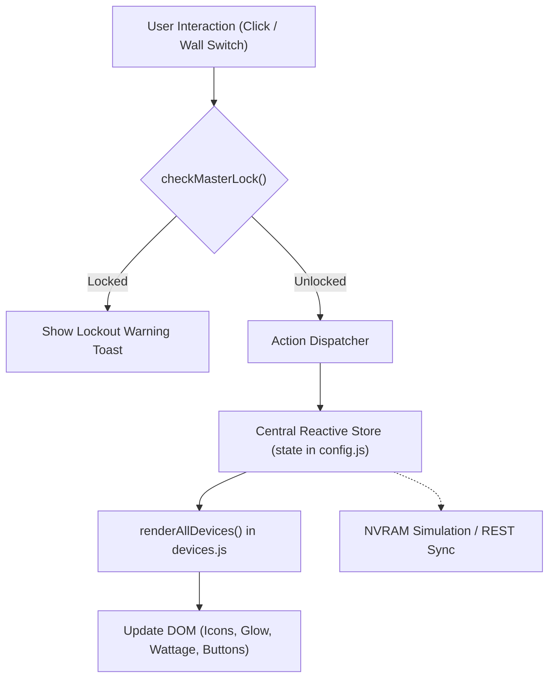

# Home 2.0 - Software Architecture & Modular Organization

## Overview

The **Home 2.0** IoT Dashboard is designed with a lightweight, dependency-free vanilla architecture that runs seamlessly both directly from the filesystem (`file://`) and through an embedded HTTP server on an ESP32 or static web hosting (GitHub Pages, Netlify).

---

## Directory Organization

```text
home-automation-/
│
├── index.html                      # Clean application layout & HTML structure
├── README.md                       # Main project overview & quickstart
│
├── assets/                         # Static front-end assets & styles
│   ├── css/                        # CSS modules
│   │   ├── style.css               # Master stylesheet combining modules
│   │   ├── theme.css               # Precision Dark & Warm Sand themes
│   │   └── animations.css          # Fan rotation & pulsing glow keyframes
│   │
│   └── js/                         # JavaScript functional modules
│       ├── config.js               # Reactive state & default device registry
│       ├── notifications.js        # Floating toast notification engine
│       ├── greeting.js             # Real-time clock & diurnal greeting
│       ├── lock.js                 # Master Lock safety authority & interlock
│       ├── devices.js              # Relay switching, load meters & wall toggles
│       ├── timers.js               # Countdown micro-timers & cron schedules
│       ├── settings.js             # Appliance customisation & NVRAM EEPROM modal
│       ├── theme.js                # UI theme toggle engine
│       └── main.js                 # Event listeners & application bootstrap
│
├── firmware/                       # Embedded C++ firmware
│   └── esp32_home_controller.ino   # ESP32 Arduino sketch with REST API & debouncing
│
└── docs/                           # Technical documentation
    ├── PINOUT.md                   # Hardware wiring & GPIO mapping
    └── ARCHITECTURE.md             # Architecture breakdown (this file)
```

---

## State Flow & Data Lifecycle



---

## Modular Responsibilities

1. **`config.js`**:
   Acts as the central single source of truth. Contains `state.masterLockArmed`, `state.theme`, and `state.devices`.

2. **`notifications.js`**:
   Provides `showToast(message, type)`. Automatically stacks, animates, and auto-dismisses toasts.

3. **`lock.js`**:
   Protects against inadvertent toggle of appliances. Checks status before any action executes.

4. **`devices.js`**:
   Handles individual channel toggling, 2-way physical wall switch synchronization, dynamic wattage load summation, and device status badges.

5. **`timers.js`**:
   Provides in-card countdown timers with 1-second ticks, scheduled triggers, and cancellation guards.

6. **`theme.js`**:
   Toggles between high-contrast dark mode and warm sand aesthetic.

7. **`main.js`**:
   Attaches DOM listeners, initiates dynamic greeting polling, and renders initial state on page load.
